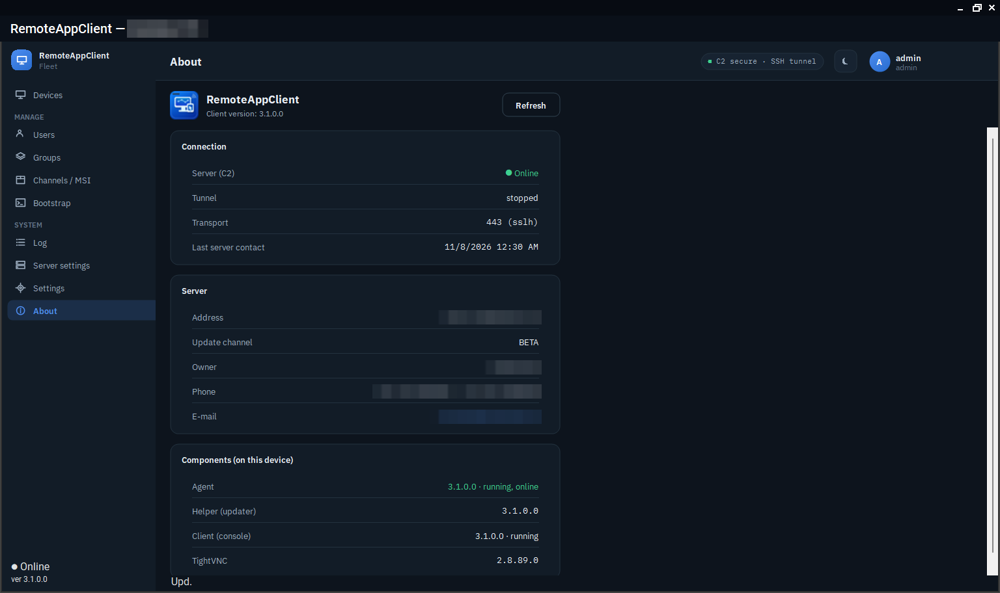

# About

RemoteAppClient is free software under the [MIT License](https://github.com/v1k70rk4/RemoteAppClient/blob/master/LICENSE), written by [v1k70rk4](https://github.com/v1k70rk4) for fleets of Windows machines that need a self-hosted way in.

## TightVNC

The desktop capture and encoding are not implemented here. TightVNC does that work as a separate process; RemoteAppClient provides the control plane, enrollment, tunnel orchestration, security model, fleet UI and update workflow around it.

The repository does not commit the TightVNC binary. `deploy/fetch-tightvnc.sh` downloads a pinned version, verifies its SHA-256 and also downloads the corresponding source archive for GPL compliance. TightVNC remains under its own GPLv2 licence; RemoteAppClient interacts with it as an installed external program and MSI package.

<figure class="shot" markdown>
{ loading=lazy }
<figcaption>The console's About page: connection, server, and the versions of the components on this device.</figcaption>
</figure>

## Use it on your own machines

Use RemoteAppClient only on systems you own or are explicitly authorized to administer. The consent prompt, the locks a device's user can set, the audit log and the branding that names the owner on every prompt are there so the people at the devices know who is looking.

## Support

If RemoteAppClient saves you time, you can support its development on [Ko-fi](https://ko-fi.com/v1k70rk4). Bugs and ideas go to the [issues](https://github.com/v1k70rk4/RemoteAppClient/issues).
