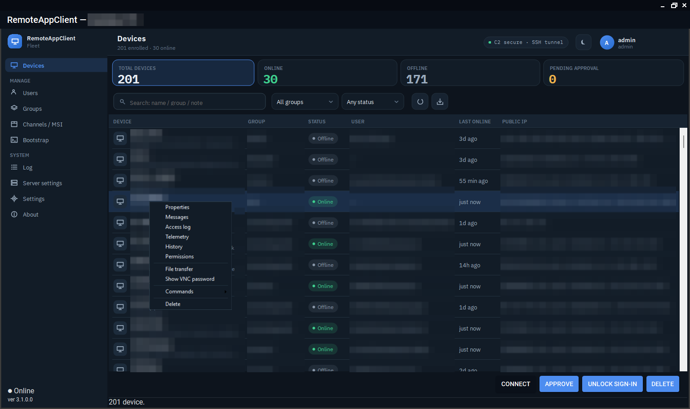
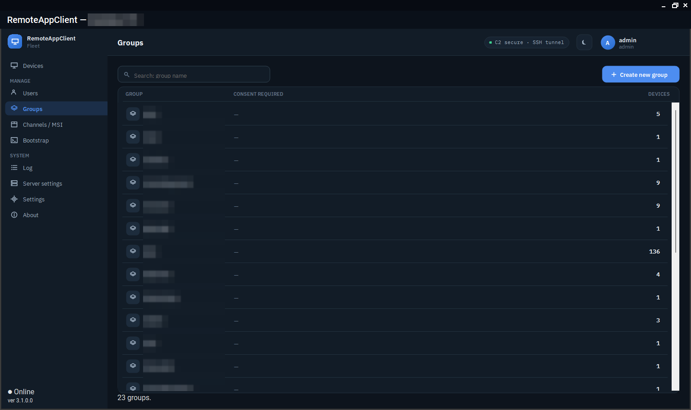
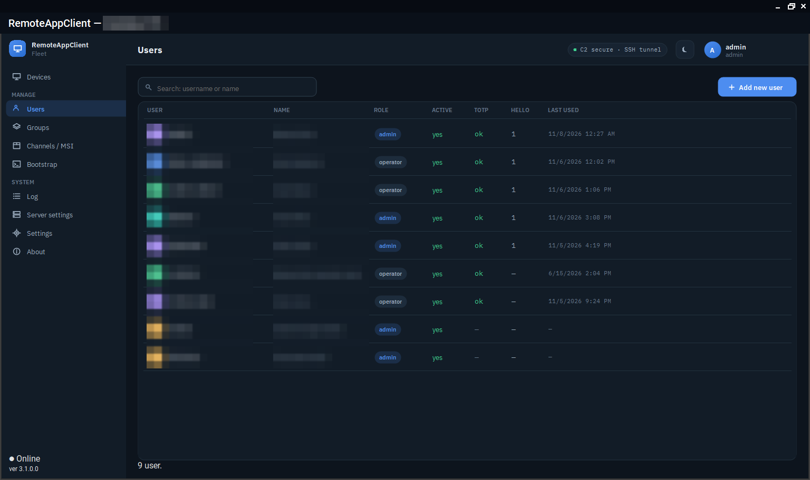
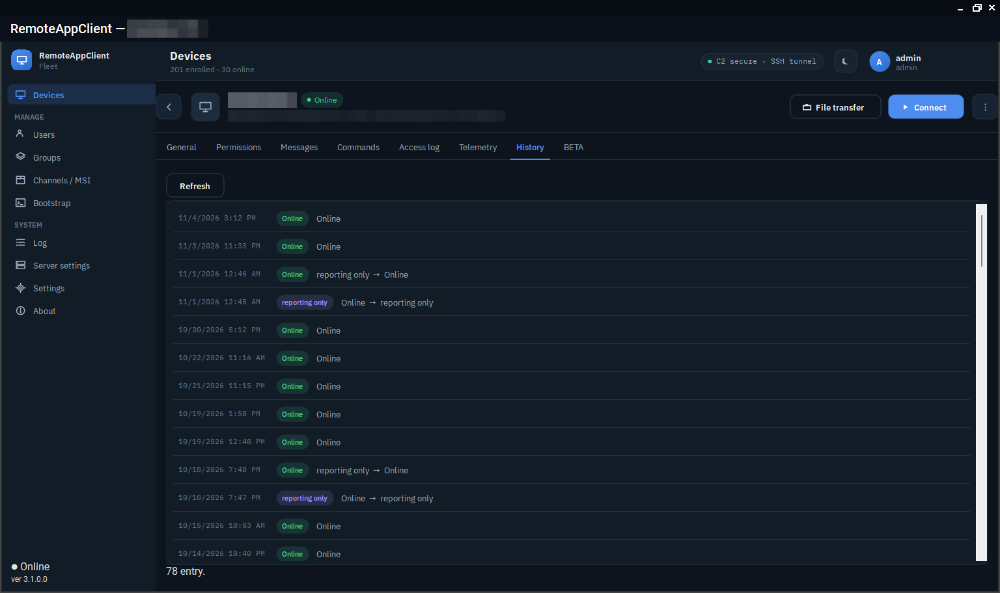
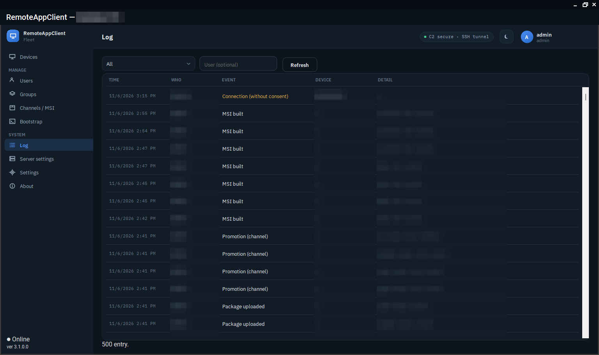

# Fleet management

## The device list

One row per enrolled device: name (a name that is in the fleet twice is numbered `1/2`, `2/2`, oldest first), group, note, state, signed-in user, last seen, local and public address with reverse name, Wi-Fi network, VPN, battery and charger, boot time, the versions of the agent, updater, console and TightVNC, where the device key is (TPM, software, file) and when its certificate ends, and the last incident the updater recorded.

The state is one of:

| | Meaning |
|---|---|
| ONLINE | The command channel is up: the device takes commands now. |
| **Reporting only** | Telemetry arrives but the command channel is down; a tunnel cannot be opened until it is back. |
| **Flaky link** | Online, but the channel dropped several times in the last hour. The agent is alive; the network is not. |
| OFFLINE | Nothing heard within the window. |
| PENDING | Enrolled with a bootstrap or MSI token and waiting for an administrator's approval. |
| **Error** | A known fault the device reported (the updater restarting a dead agent, a package that does not take, a lost TPM key) with what to do about it. |

The stat cards above the list are filters; the search box narrows by name, group and note; the group and state dropdowns do the rest. The list refreshes every ten seconds.

<figure class="shot" markdown>
{ loading=lazy }
<figcaption>A device's menu: properties, messages, the access log, telemetry, history, permissions, file transfer, the session's VNC password, commands.</figcaption>
</figure>

## Groups

Devices belong to a group, and the group carries the access policy: whether the signed-in user has to consent, which operators may reach it, and the MSI built for it. An administrator changes a device's group from its properties; a bulk import takes `name;note` lines to fill notes for a whole fleet.

<figure class="shot" markdown>
{ loading=lazy }
<figcaption>Groups, each with its consent policy and its device count.</figcaption>
</figure>

## Users, roles and grants

Two roles: **administrators** see and change everything; **operators** see the devices and groups they were granted and can open tunnels only for those. Sign-in is username and password with Argon2id, plus a TOTP code, or Windows Hello registered for the account on that machine. Passwords are reset by an administrator or recovered by the user with a code sent by e-mail (SMTP or Microsoft Graph, configured in the server settings). A **keyless operator** flag lets an account use the Lite and Linux consoles, which hold no device key.

A device's console sign-in is locked after five bad passwords for an hour (an administrator can clear it early); keyless sign-ins are locked by source address.

<figure class="shot" markdown>
{ loading=lazy }
<figcaption>Users: role, TOTP and Windows Hello state, last sign-in.</figcaption>
</figure>

## Audit and history

Every access, enrollment, package, user, settings and security event is in the audit log with its actor, target and time, kept for a year. Each device has a 90-day **history** of state changes and address changes, sampled from its telemetry, so "when did it go offline last night" is one click.

<figure class="shot" markdown>
{ loading=lazy }
<figcaption>A device's history: state changes, sampled from its telemetry.</figcaption>
</figure>

<figure class="shot" markdown>
{ loading=lazy }
<figcaption>The audit log: who did what, to which device, when.</figcaption>
</figure>

## Branding and language

The server settings carry the owner's name, support phone and e-mail, which the device shows on its consent prompt and messages. Every console and every string the agent shows is in English and Hungarian; one language setting per device applies to every local executable.
