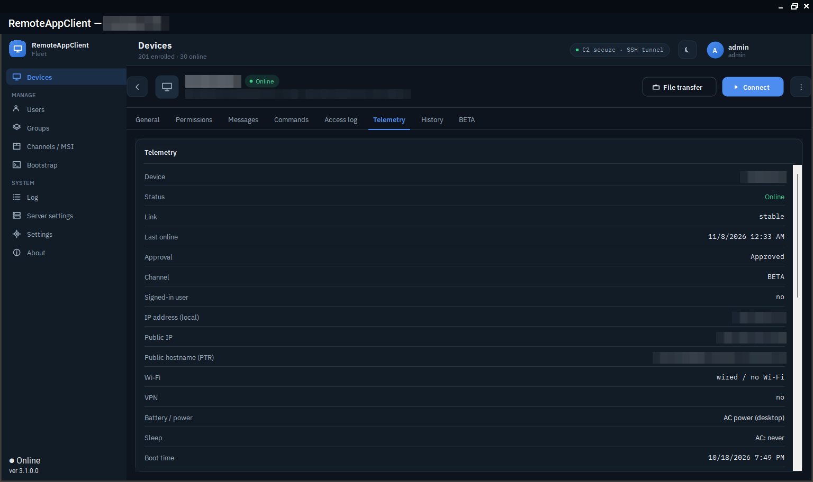

# Remote access

## Connect

Pick a device, click **Connect**. The console asks the server for a tunnel; the server signs an open-tunnel command for the device and the agent brings its reverse SSH tunnel up to the bastion, on the port the server reserved for that device. The console reaches the port through the local agent's broker, waits for the VNC server's greeting and launches TightVNC viewer. Two numbers in the status bar say how long the device took to answer and how long the tunnel and VNC took after that.

<figure class="shot" markdown>
{ loading=lazy }
<figcaption>A device's telemetry before connecting: link, signed-in user, addresses, Wi-Fi, VPN, power, sleep limits, boot time.</figcaption>
</figure>

The agent tries the bastion over raw SSH on 443 first and falls back to SSH over a WebSocket when a network lets only TLS through; the transport can also be fixed per device. A tunnel the operator stopped using closes on its own after the idle time; a device that lost its network and came straight back waits out the bastion's hold on its old port instead of giving up.

A **second operator** joining a device with a session open shares it: TightVNC runs shared and the tunnel multiplexes the extra viewer.

## The session password

The VNC password belongs to the session, not the device. The server chooses one at open-tunnel, the agent gets it in the signed command and sets it on its VNC server before the tunnel comes up, and the operator gets the same one together with the device's positive answer - never before someone at the device has let the request in. One password is kept for an hour from the time it was chosen, so a reconnect or a second operator within the hour reuses it without a VNC restart; it is not rotated under a running session, and the next open after the session has gone chooses a new one.

## Consent

Every group decides whether an operator may connect unattended or has to be let in. With consent required, the signed-in user sees a prompt naming the operator and the owner's branding; *Yes* opens the tunnel, *No*, no answer or nobody signed in keeps it closed, and the operator is told which. The agent evaluates exactly one thing - *consent required* - so what the group says is what happens.

Before asking for the screen, an operator can send an **availability question** ("Is it a good time?") or a plain **message**; the answer comes back to the console. A device that is asleep can be given a queued request: *connect as soon as it wakes* delivers the command in the first second of the next wake, when a laptop is still awake.

## File transfer

**Files** opens a two-pane file manager - the operator's machine on one side, the device on the other - over a port of its own in the same tunnel, with a token the session alone knows. A file session brings up the file port alone, so a password from an earlier screen session finds no VNC behind it. Uploads land in a part file and replace the destination only once complete. The panes sort by name, size or date.

## Messages and power

From the device's menu: restart, forced restart, cancel a pending restart, sign the user out. A restart is announced to the signed-in user and can be cancelled from the console; the device reports what it did.

## Locks set at the device

Two locks that only someone at the device can set, and nothing remote can undo: no remote screen (`RemoteAgent.exe vnc-lock`) and no file transfer. Both show in the console's device list, and the file lock ends a transfer in flight, every five seconds and on every request. A session does not survive a lock-and-unlock either, however brief.

## When a device sleeps

The agent reports its battery, charger and the device's standby time limits, so the console can say *this laptop sleeps after ten minutes on battery* before the operator starts. During a session the agent holds the device awake. A device whose telemetry arrives late after a nap is not reported as having a wrong clock: the server needs two agreeing reports before it says so.
