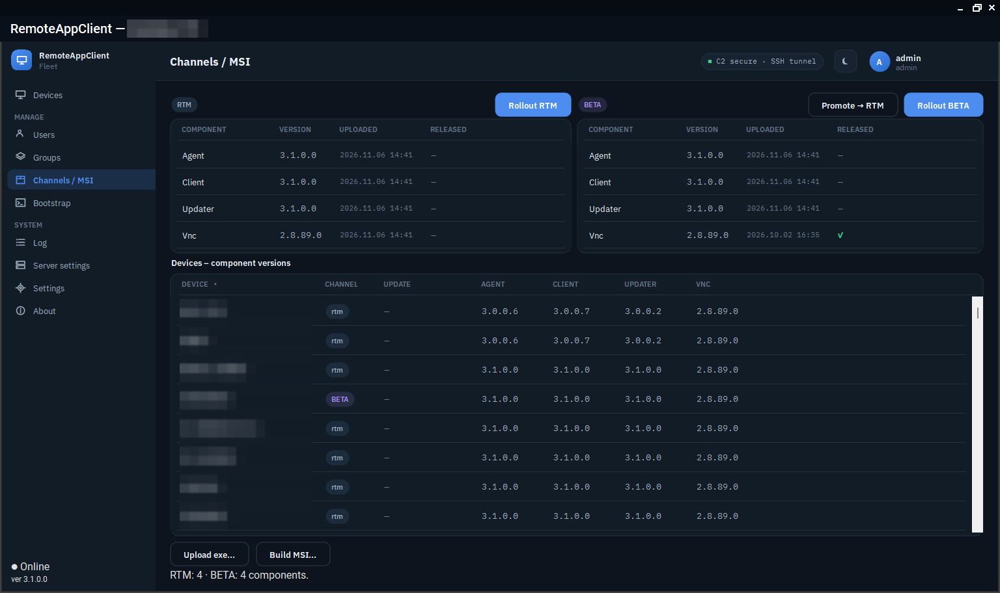
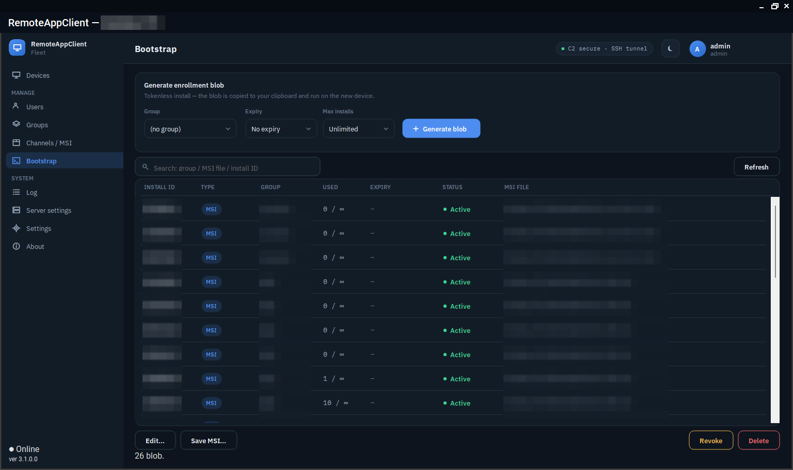

# Updates and packages

## Channels and components

Two channels, `rtm` and `beta`, each device on one of them. Four components: `agent` (`RemoteAgent.exe`), `updater` (`RemoteAgent.Updater.exe`), `client` (`RemoteClient.exe`) and `vnc` (the TightVNC MSI). Upload a package to a channel in the console (*Packages*), promote a beta package to RTM when it has proven itself, and the devices on the channel get it.

The server stores the package, computes its SHA-256 and puts the hash into the signed update command; the agent downloads it, verifies the hash and only then stages it. The store keeps, per channel and component, the current package and the one before it.

<figure class="shot" markdown>
{ loading=lazy }
<figcaption>Channels: the packages on rtm and beta, and every device with the versions it runs.</figcaption>
</figure>

## How a rollout reaches a device

- Every ten seconds the server offers each online device one component it is behind on, in the order `vnc`, `client`, `updater`, `agent`.
- The agent waits a minute before it starts the download: the command tends to arrive the moment a laptop comes back from sleep, when its link is at its flakiest.
- A rollout of several packages lands within that minute; the agent queues them and runs them in the server's order, its own package last, since that one restarts the process.
- The console is replaced in place; the updater and the agent are staged, and the **updater** swaps the agent's executable (and the agent swaps the updater's), so the service is never without a supervisor.
- A package that did not take after three attempts in six hours is paused for six hours, then tried again. The note on the device says when.

The device list shows every component's version, so a rollout is watched from the list.

## MSI installers

*Groups → the group → Build MSI* builds a Windows installer on the server for that group: the agent and the updater, optionally the console with a Start-menu shortcut, the bundled TightVNC MSI, and an embedded bootstrap blob tied to the group. Hand it to Intune or run it by hand on the device; the device enrolls on first start and waits for approval. The installer's product code is stable across versions, so Intune sees one application. With a signing certificate configured on the server, the MSI is Authenticode-signed.

<figure class="shot" markdown>
{ loading=lazy }
<figcaption>Bootstrap: enrollment blobs and the MSI built for each, with how often each was used.</figcaption>
</figure>

`RemoteAgent.exe` also installs and removes the service by hand - see [Commands](../reference/commands.md).

## The server updates itself

*Server settings → Server update* (or `racctl update`) uploads a server package to the box; the helper installed by `10-selfupdate` stops the service, keeps a backup of the binaries and the database, applies the package and an optional SQL script, starts the service and checks its health. If the service does not come up, the helper rolls back by itself; `racctl rollback` does it on request. The console has no shell on the server for any of this: the helper is a root-only script started by a systemd path unit, and the service user only drops the package in a directory.

## Keeping an eye on it

The console's *Packages* page and the device list show what is where; a device whose update is stuck shows the reason in its note; `racctl status` prints the server's own update state.
