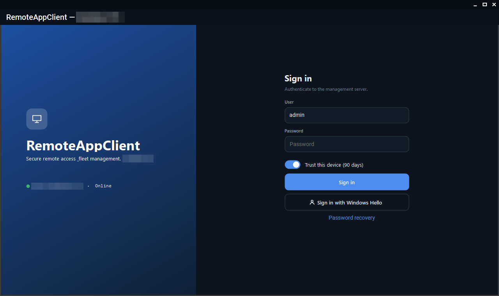
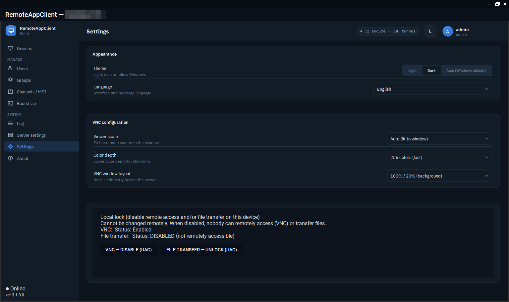

# The consoles

Four ways to reach the server. All of them go through a tunnel to the bastion; what differs is who holds the key for it.

| | Runs on | Reaches the server through | Can do |
|---|---|---|---|
| **Windows console** (`RemoteClient.exe`) | An enrolled Windows device | The local agent's broker: a named pipe to the SYSTEM service, which opens `ssh -L` with the **device's** identity | Everything: devices, groups, users, packages, MSIs, server settings and update |
| **Lite console** (`RemoteClient.Lite.exe`) | Any Windows machine, no agent | A short-lived SSH certificate the server mints at sign-in for an ephemeral key | View the fleet, connect, transfer files |
| **Linux console** (`.deb`) | Debian or Ubuntu | The same ephemeral certificate | View the fleet, connect |
| **`racctl`** | An enrolled Windows device | The local agent's broker, with a read-only API token | Read the server log, health, fleet and audit; apply a server update with an update-scoped token |

## The Windows console

Run `RemoteClient.exe` on a device whose agent is enrolled; there is nothing to configure. The console self-updates when the server's *minimum console version* says it must, and it follows its own `rtm`/`beta` channel. Sign in with username, password and TOTP code, or with Windows Hello once registered for the account on that machine.

<figure class="shot" markdown>
{ loading=lazy }
<figcaption>The sign-in window: password and TOTP, Windows Hello, password recovery.</figcaption>
</figure>


What you see first is the device list: the stat cards at the top (all, online, offline, awaiting approval) are also filters, the search box narrows by name, group or note, and every row carries the device's state, user, network, versions and last incident. Right-click a device for files, messages, power actions, verbose logging and the rest.

Settings live in `%APPDATA%\RemoteClient\config.json`; the TightVNC viewer's scale and colour depth and the UI language are set in the console. `ViewerExe` points at `tvnviewer.exe` (`C:\Program Files\TightVNC\tvnviewer.exe` by default).

<figure class="shot" markdown>
{ loading=lazy }
<figcaption>The console's settings: theme, language, the viewer's scale and colour depth, and the locks of this device.</figcaption>
</figure>


## The Lite console

The Lite console is the Windows console without administration, for an operator's own laptop that is not an enrolled device. At sign-in the server mints a 12-hour operator SSH certificate for a key the console generates and throws away at exit; the account needs the **keyless operator** flag, set by an administrator in the Windows console (*Users → the user → Keyless operator*). Without the flag the server mints no certificate and the sign-in is refused. Its settings are in `%APPDATA%\RemoteClient.Lite`.

Wrong passwords against the keyless sign-in are counted **per source address**, not per account: five failures lock that address out for an hour, and an administrator sees the lock in the device list.

## The Linux console

*Multiserver Linux RemoteAppClient Lite* is the same viewer-only console for Linux, built with Avalonia. It needs `openssh-client` for the tunnels and `ssvnc` (preferred: fit-to-window scaling and a 256-colour mode) or `tigervnc-viewer`; both are dependencies of the package.

```bash
sudo apt install ./remoteclient_<version>_amd64.deb
```

Sign in (server URL, username, password, TOTP when required), pick a device and **Connect (VNC)**. The device table is sortable and searchable; *Settings* adjusts the scaling, the 256-colour mode and the language (auto, English, Hungarian). *Forgot password?* runs the same code-based recovery as the Windows console. The console can hold several servers.

## `racctl`

`racctl` is read-only access to the server from the command line, for scripts and for a look at the log without opening the console. It is not a release asset; build it where you use it:

```powershell
dotnet publish src/RemoteClient.Cli/RemoteClient.Cli.csproj -c Release -o C:\tools\racctl
C:\tools\racctl\racctl.exe token              # paste the token when asked (never on the command line)
C:\tools\racctl\racctl.exe logs --level warn --since 2h
```

The token is minted in the console (*Server settings → Diagnostics → Access tokens*) and stored DPAPI-protected for the current user. It works only on an enrolled device with the agent running, and only for the read routes; a token minted with the *server update* permission can also stage and apply a server package (`racctl update`, `racctl rollback`). The rest: `diag`, `status`, `devices`, `events <deviceId>`, `audit`, and `get /admin/<path>` for any read-only admin route.
