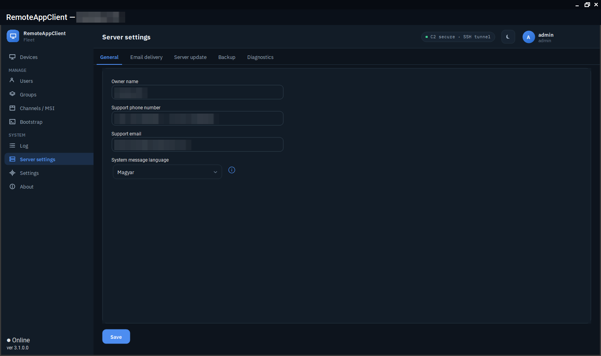

# The server

`deploy/setup.sh` takes a fresh server from zero to a running `RemoteServer`, then verifies it. Run it **on the server**, as a user with passwordless sudo:

```bash
git clone https://github.com/v1k70rk4/RemoteAppClient.git
cd RemoteAppClient
./deploy/setup.sh
```

It asks a few things up front - the public DNS name, an ACME e-mail address, and **whether you have your own MariaDB** (otherwise it installs one) - then runs to the end. It is idempotent, and each step can run on its own:

```bash
./deploy/setup.sh 06-tls 07-nginx       # a subset, in order
./deploy/setup.sh 11-verify             # just re-verify
```

For an unattended run, copy `deploy/config.env.example` to `deploy/config.env` and fill it in.

## What the steps do

| Step | What it leaves behind |
|---|---|
| `01-prereqs` | Packages the rest needs. |
| `02-mariadb` | MariaDB and its database and user (or your external database), `/etc/remoteserver/db.env`. |
| `03-schema` | The baseline schema loaded into the database (`RAC_SCHEMA_FORCE=1` reloads it). |
| `04-server` | `/opt/remoteserver`, the command-signing key, the client CA, `secret.key`, `bastion.env` (with `PublicUrl`), the systemd unit, the package directory. Secrets that already exist are **reused**, never regenerated. |
| `05-bastion` | The restricted `agent` SSH user, the SSH CA, the sshd `Match` block, and the listen-rights script that lets a device bind its reverse port only while an operator is asking. |
| `06-tls` | A Let's Encrypt certificate through Cloudflare DNS-01. |
| `07-nginx` | The 443 multiplexer: SSH and HTTPS/WSS on one port, mTLS for `/agent`, `/ssh` and `/api/*`, `/admin/*` on localhost only. |
| `08-harden` | UFW, fail2ban, sshd hardening. |
| `09-blob` | The first bootstrap blob and the first admin login. |
| `10-selfupdate` | The helper the console-driven server update uses (systemd path units and root-only scripts). |
| `11-verify` | Checks the whole thing end to end. |

TLS uses Let's Encrypt with Cloudflare DNS-01: the script prompts for a Cloudflare API token (Zone → DNS → Edit), or place it at `/etc/letsencrypt/cloudflare.ini` first. No Cloudflare? Issue the certificate yourself and skip `06-tls`.

At the end, `09-blob` prints the bootstrap blob **and the first admin login**: `admin` with a temporary password to change at the first sign-in. The password is kept in `/var/lib/remoteserver/first-admin-password.txt`, readable by the service user only, and the file is removed once the password has been changed.

## The port

Everything comes in on **443**: the agents' WebSocket, their telemetry, the raw SSH of the reverse tunnels and the WebSocket-bridged SSH for networks that let only TLS through. nginx tells them apart and hands each to the right place; the server's own listener and `/admin/*` stay on localhost. Managed devices need **no inbound ports** at all, and the operator reaches the admin API only through a tunnel.

## Troubleshooting

```bash
sudo systemctl status remoteserver
sudo journalctl -u remoteserver -f
sudo nginx -t && sudo tail -f /var/log/nginx/error.log
```

| Symptom | Check |
|---|---|
| `09-blob` reports a missing `PublicUrl` | Set `Server__PublicUrl` in `/etc/remoteserver/bastion.env` and restart `remoteserver`. |
| `09-blob` reports a missing schema | Re-run `./deploy/setup.sh 03-schema`. |
| An agent enrolls but the console cannot connect | Is the agent service running? Is the bastion host key present in `bastion.env`? |
| `/agent` or `/api/*` returns 403 | nginx's mTLS and the client CA. |
| `/admin/*` is unreachable from the internet | Expected: localhost only, reached through an enrolled device's tunnel. |
| TightVNC is not installed on a device | The pinned MSI has to sit at `vnc\tightvnc.msi` next to the agent before the service starts, or run `RemoteAgent.exe provision-vnc --msi <path>` elevated. |

The server also keeps its own log file and a health snapshot that the console (*Server settings → Diagnostics*) and `racctl` read without a shell on the box: see [Diagnostics](../features/diagnostics.md).

<figure class="shot" markdown>
{ loading=lazy }
<figcaption>Server settings: the owner and support contact the devices show, the language of system messages; the other tabs hold e-mail delivery, the server update, backup and diagnostics.</figcaption>
</figure>


## Moving to another box

Devices are never imported: an agent's identity lives on the device. What the agents **pin** is what has to survive on the server - the command-signing key, the bastion's SSH host key and the client CA. That is about 2 KB of secrets plus one host key, and `deploy/backup.sh` puts them in one archive:

```bash
./deploy/backup.sh                                   # on the OLD box
#   ... rebuild the box, keep the same DNS name ...
./deploy/restore.sh racd-identity-<ts>.tar.gz        # 1. secrets + bastion host key
./deploy/setup.sh                                    # 2. finds them and REUSES them
./deploy/restore.sh racd-identity-<ts>.tar.gz --db   # 3. database; agents then reconnect on their own
```

The order is the whole trick: `04-server` only generates secrets that are missing. Restore first and the installer adopts the fleet; run it first and it mints new keys that lock every device out. The archive holds the private keys of the whole fleet: store it encrypted, off the box. What each key protects and which can be rotated: [Keys and certificates](../security/keys.md).

## Updating the server later

A new server package is applied from the console (*Server settings → Server update*) or with `racctl update RemoteServer-linux-x64.tar.gz`: the helper installed by `10-selfupdate` stops the service, keeps a backup of the binaries and the database, applies the package and an optional SQL script, and rolls back by itself when the service does not come up. See [Updates and packages](../features/updates.md#the-server-updates-itself).
