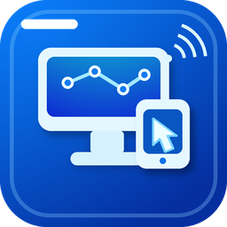
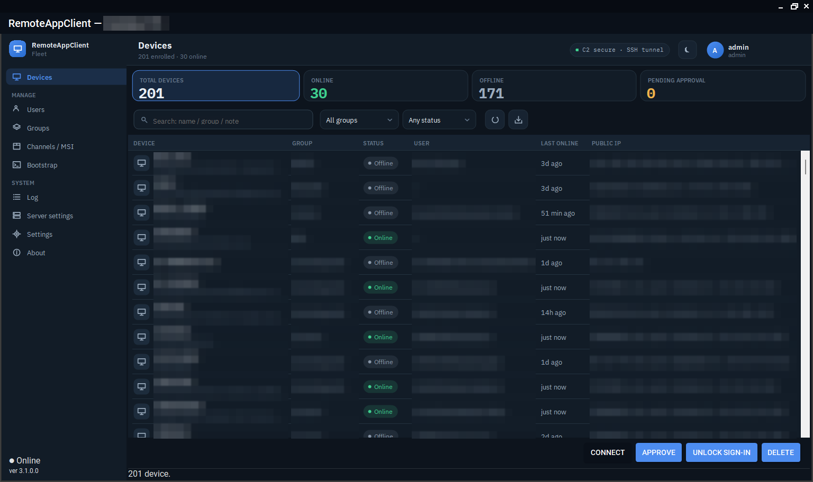

{ .logo }

.NET 10 · WINDOWS AGENT · LINUX SERVER

# RemoteAppClient

Self-hosted remote access and fleet management for Windows devices: a SYSTEM agent that only ever dials out, a Linux server that signs every command, and operator consoles that reach the screen through a reverse SSH tunnel to TightVNC.

[:material-download: Download](https://github.com/v1k70rk4/RemoteAppClient/releases/latest){ .md-button .md-button--primary }
[:material-rocket-launch: Get started](getting-started/index.md){ .md-button }
[:material-github: GitHub](https://github.com/v1k70rk4/RemoteAppClient){ .md-button }

<figure class="shot" markdown>
{ loading=lazy }
<figcaption>The console: every device with its state, user, network and last contact; the cards above the list are filters.</figcaption>
</figure>

## Three pieces

**The agent** :material-microsoft-windows:

A Windows service running as SYSTEM on every managed device. It keeps an outbound WebSocket to the server, verifies the signature of every command it receives, reports telemetry every minute, provisions TightVNC, and opens a reverse SSH tunnel only when an operator asks. No inbound ports.

**The server** :material-linux:

ASP.NET Core on a Linux box with MariaDB, behind nginx on one port. It owns enrollment, signs commands with a P-256 key the agents pin, authenticates operators (password, TOTP, Windows Hello), keeps the audit log, and serves release packages to the fleet. One script installs it from scratch.

**The consoles** :material-monitor-dashboard:

A Windows console for operators and administrators, a viewer-only Lite console, a Linux console and `racctl` on the command line. They reach the server through a tunnel the local agent brokers, so an operator's machine holds no key to the bastion.

## What it does

-   :material-remote-desktop:{ .lg .middle } **Remote access**

    ---

    A click opens the device's screen: the agent brings its tunnel up, the server hands the operator a password chosen for that session, and TightVNC shows the desktop. Consent prompt or unattended, per group.

    [:octicons-arrow-right-24: Remote access](features/remote-access.md)

-   :material-folder-sync:{ .lg .middle } **File transfer**

    ---

    A two-pane file manager over the same tunnel, on a port of its own, with a token the session alone knows. A lock set at the device ends a transfer in flight.

    [:octicons-arrow-right-24: Files](features/remote-access.md#file-transfer)

-   :material-view-list:{ .lg .middle } **The fleet at a glance**

    ---

    Online ONLINE, reporting only, flaky link, offline OFFLINE, awaiting approval PENDING: who is signed in, which network, on battery or charger, when it last booted, what went wrong last.

    [:octicons-arrow-right-24: Fleet management](features/fleet.md)

-   :material-account-group:{ .lg .middle } **Groups, roles and grants**

    ---

    Device groups with an inherited access policy; administrators and operators; an operator sees the devices and groups they were granted and nothing else. Every action is in the audit log.

    [:octicons-arrow-right-24: Users and groups](features/fleet.md#users-roles-and-grants)

-   :material-update:{ .lg .middle } **Updates and packages**

    ---

    `rtm` and `beta` channels for the agent, the updater, the console and TightVNC. Upload, promote, roll out; the agent verifies the hash and applies a rollout one package at a time. The server updates itself from the console.

    [:octicons-arrow-right-24: Updates](features/updates.md)

-   :material-package-variant:{ .lg .middle } **MSI per group**

    ---

    The server builds an installer per device group: agent, updater, optional console, TightVNC and an embedded enrollment blob. Hand it to Intune or run it by hand; the device turns up pending approval.

    [:octicons-arrow-right-24: Installers](features/updates.md#msi-installers)

-   :material-shield-lock:{ .lg .middle } **Security first**

    ---

    Per-device client certificates with the key in the TPM, pinned server certificate, signed and device-bound commands with replay protection, a bastion that lets a device listen only while an operator is asking, Argon2id passwords, secrets encrypted at rest.

    [:octicons-arrow-right-24: Security model](security/index.md)

-   :material-stethoscope:{ .lg .middle } **Diagnostics**

    ---

    The server's own log and health snapshot from the console or `racctl`, verbose logging on a device for a day, device history, health alerts by e-mail.

    [:octicons-arrow-right-24: Diagnostics](features/diagnostics.md)

-   :material-translate:{ .lg .middle } **English and Hungarian**

    ---

    Every console, prompt and log line in both languages, chosen per device or following the system.

    [:octicons-arrow-right-24: Configuration](reference/configuration.md#shared-language-setting)

## How a session happens

1. The operator picks a device in the console and clicks **Connect**.
2. The server chooses a VNC password for the session, writes a two-minute grant for the device's ports on the bastion, and sends the agent a signed open-tunnel command.
3. The agent checks the signature, asks the signed-in user when the group requires consent, sets the password on its VNC server, and opens `ssh -R` to the bastion on its own port.
4. The console gets the device's answer and the password together, reaches the bastion port through the local agent's broker, waits for the RFB greeting and launches TightVNC viewer.
5. The tunnel closes when the session ends or sits idle; nothing on the device listens from the outside.

[Read how the pieces fit together](reference/architecture.md){ .md-button }

!!! note "Use it on your own machines"
    RemoteAppClient is for systems you own or are explicitly authorized to administer. The desktop capture is TightVNC's work, a separate program under its own GPLv2 licence; RemoteAppClient is the control plane around it.
